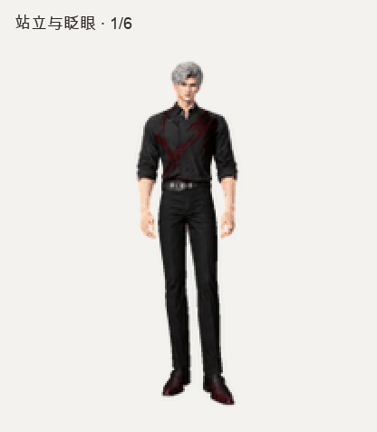

# 秦彻桌宠 · Sylus Pet

以《恋与深空》秦彻为灵感制作的 **3D 风格同人桌宠素材**。保留成熟、修长的身形，包含九组动作和十六方向视线。

## 直接下载

- **[下载完整分享包](sylus-pet-v1.0.0.zip)**：解压后双击 `preview.html`，即可离线切换动作、查看鼠标跟随视线。无需会员或安装软件。
- **[下载兼容版 PNG](sylus-v1.png)**：九组动作，适用于要求 `1536 × 1872` 的上传入口。
- **[下载完整版 PNG](sylus-v2.png)**：九组动作加十六方向视线，适用于支持 v2 的 Pets 工具。

打开单个文件链接后，点击 GitHub 的 **Download raw file** 下载原文件。也可用仓库右上方 **Code → Download ZIP** 下载整个仓库。

## 在 ChatGPT 中使用

### 有「Upload pet／上传宠物」入口

在网页设置中打开 **Personalization → Pet → Select pet → Upload pet**，上传 `sylus-v1.png` 并选中它。网页宠物显示在支持的 Work 聊天中。

这一入口及九行文件要求来自 [OpenAI 官方 Pets 文档](https://learn.chatgpt.com/pets)。入口是否出现取决于账号、工作区及客户端；下载和离线预览本仓库本身不需要付费。

### 已连接支持 v2 的 Pets 工具

把 `sylus-v2.png` 作为附件交给能调用 Pets 工具的 ChatGPT Work，并发送：

> 请使用这张现成的 v2 精灵图创建名为「秦彻」的宠物。保留图片，先验证格式，通过后上传、创建并启用。

该 v2 文件已通过本地检查和 Pets 工具验证，并成功创建。不同账号的工具可用性可能不同。

### 桌面悬浮宠物

桌面版可在 **Settings → Pets** 选择宠物，再用 `/pet` 或 **Show pet** 显示。桌面与网页宠物不会自动同步；桌面端对现成素材的导入方式请以你的客户端为准。[官方说明](https://learn.chatgpt.com/pets)

完整说明见 [使用指南](USAGE.md)。本仓库分享现成动画资源和预览代码，不包含 ChatGPT 服务、AI 对话模型或独立系统悬浮窗口程序。

## 动作

| 动作 | 帧数 | 内容 |
| --- | ---: | --- |
| idle | 6 | 站立、呼吸、眨眼 |
| running-right | 8 | 向右跑 |
| running-left | 8 | 向左跑 |
| waving | 4 | 挥手 |
| jumping | 5 | 起跳、离地、落地 |
| failed | 8 | 低头叹气、扶额 |
| waiting | 6 | 等待回应 |
| running | 6 | 思考中 |
| review | 6 | 检查完成 |

完整版另外包含从正上方开始，顺时针每隔 22.5° 的十六个视线方向。

## 文件与二次制作

- `sylus-v1.png`、`sylus-v2.png`、`manifest.json`：图集与动画配置。
- `preview.html`：不依赖第三方库的离线预览源代码。
- `all-states.gif`、`look-loop.gif`、`all-states.mp4`、`motion-stills.png`：预览与关键帧。
- `FORMAT.md`：尺寸、每行帧数、视线方向。
- `ART-DIRECTION.md`：形象和比例的制作要求。
- `QA.md`：已完成的检查、版本与播放限制。
- `ASSET-NOTICE.md`：同人素材与原角色权利说明。

此项目的图片由 AI 生图制作，并经人工挑选、比例修正和动画检查。外观采用 3D 游戏风格，文件是预渲染透明精灵图。

## 许可与致谢

`preview.html` 的预览代码采用 [MIT 许可](LICENSE)。图片和角色相关内容适用 [素材声明](ASSET-NOTICE.md)，不属于 MIT 代码许可的范围。

秦彻／Sylus 及《恋与深空》的角色设计、名称、服饰与商标属于原权利人。本项目为非官方同人分享，与原游戏开发及发行方、OpenAI 均无隶属或合作关系。
